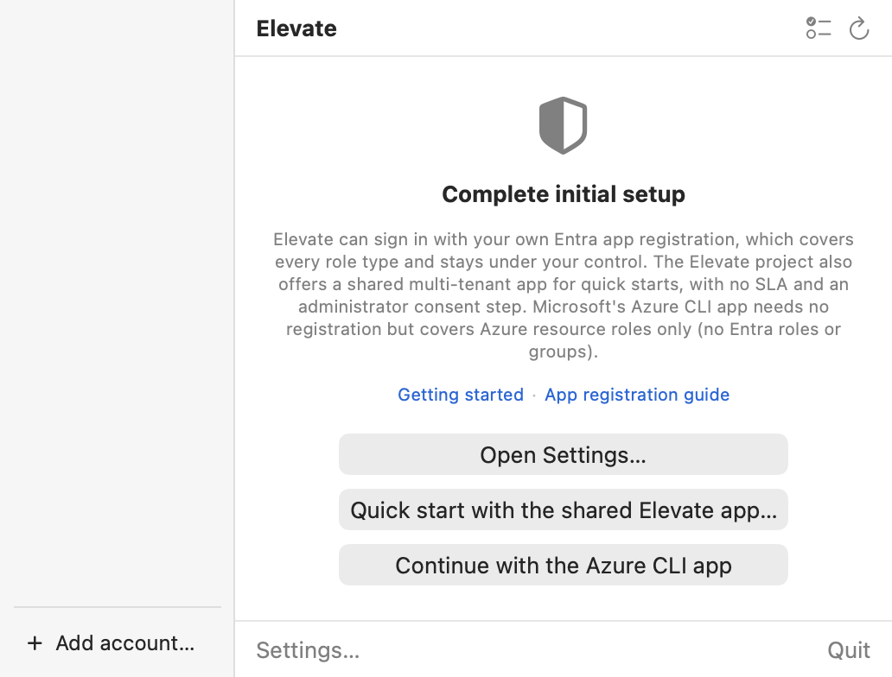
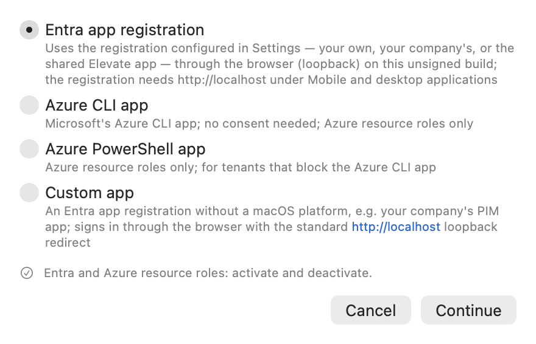
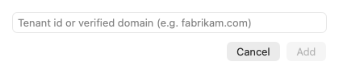
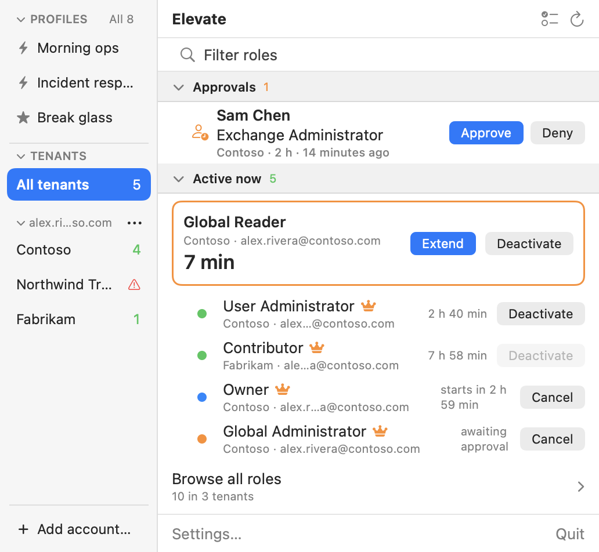
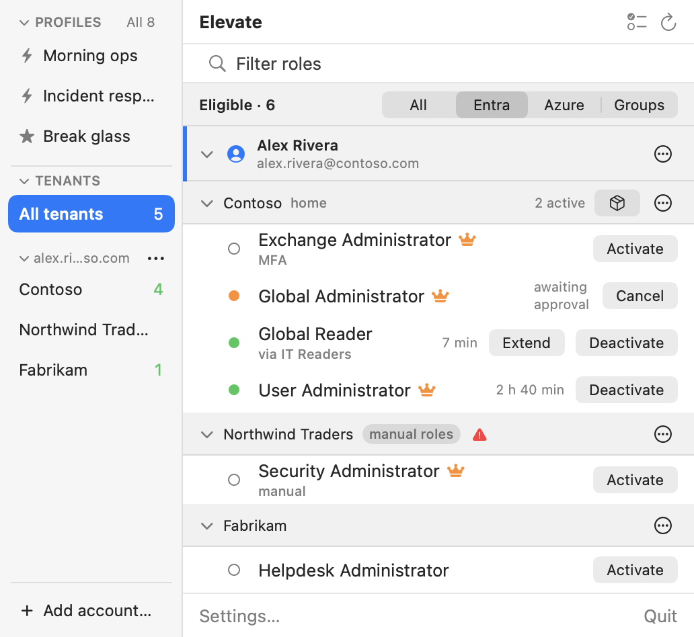
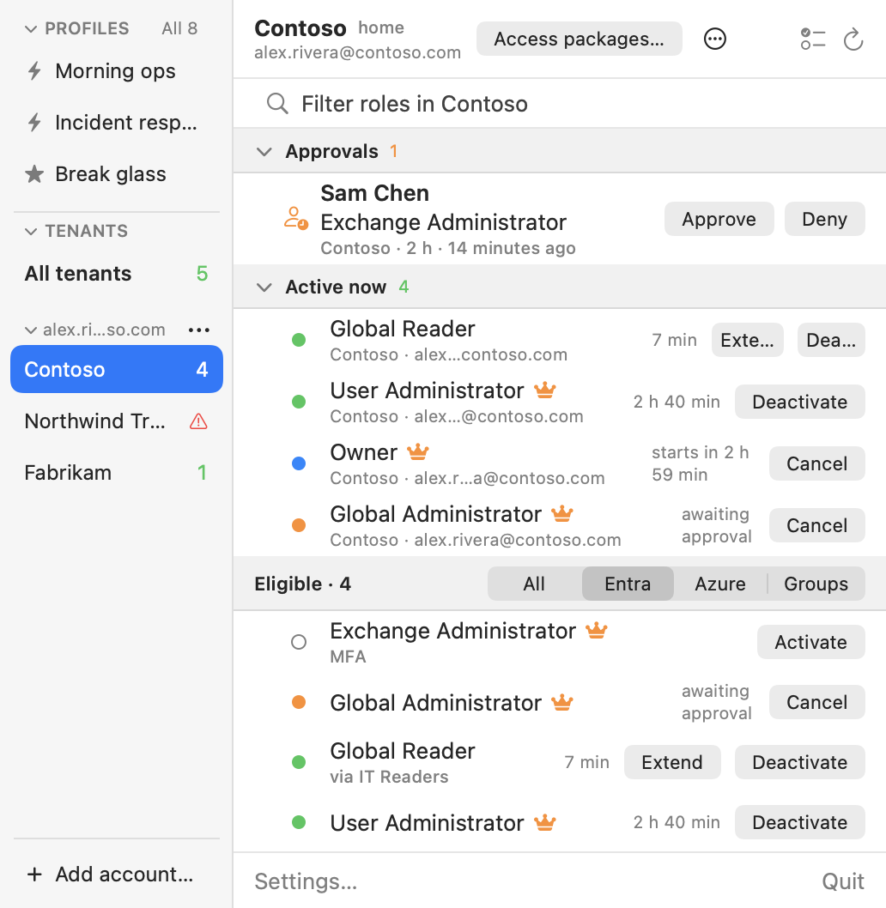
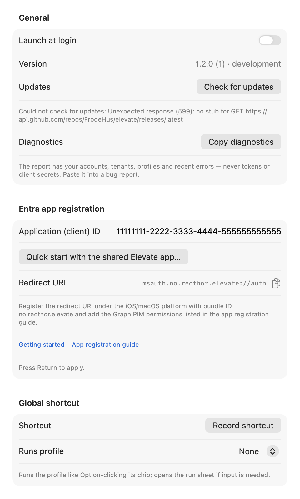

# Getting started with Elevate

Elevate lets you activate the Microsoft Entra roles, Azure resource roles and PIM for Groups
memberships you are eligible for, across every account and tenant you use. It runs in the macOS
menu bar, in the Windows system tray, and as the `elevate` command in a terminal on Linux, macOS
and Windows. This guide takes you from a fresh install to a panel full of roles.

> The pictures in this guide are real renders of the macOS app with sample data from a fictional
> organization. Elevate for Windows has the same controls in the same places, drawn in the
> Windows style; where it differs, the guide says so. On Windows, Ctrl takes the place of Option
> and confirmations open as dialogs instead of cards inside the panel.

Other guides: [Activating roles](activating-roles.md), [Profiles and shortcuts](profiles-and-shortcuts.md),
[Approving requests](approvals.md), [Requesting access packages](access-packages.md),
[Troubleshooting](troubleshooting.md), [The shared Elevate app](shared-app-registration.md).

## 1. Install

Pick your platform:

- **macOS 26 (Tahoe).** Install with Homebrew or download the DMG; both are described in
  [macos/README.md](../macos/README.md#install). The Homebrew cask installs the installer package,
  which also puts the `elevate` command on your PATH on Apple Silicon. Releases are signed and
  notarized, so the app opens without Gatekeeper prompts. After the first launch, its icon (a
  double chevron) sits in the menu bar. Click it to open the panel.
- **Windows 11.** `winget install Reothor.Elevate`, or download the per-user MSI from the
  [latest release](https://github.com/FrodeHus/elevate/releases/latest) and run it; the steps,
  including the .NET runtime it needs, are in [windows/README.md](../windows/README.md#install).
  Either installs the app and the `elevate` command for the current user, no admin rights needed.
  The MSI is code-signed (publisher "Open Source Developer Frode Hus"). SmartScreen may still
  ask once while a new release builds reputation: check that the publisher name is shown, then
  choose **More info** and **Run anyway**. Elevate then lives in the notification area:
  left-click the icon for the flyout, right-click for Open, Settings and Quit.
- **The CLI on Linux, macOS or Windows.** Homebrew, a single binary from the release, or the
  copy bundled with the macOS package and the Windows MSI; see
  [cli/README.md](../cli/README.md#install). The rest of this guide describes the apps; the CLI
  equivalent of each step is in [cli/README.md](../cli/README.md#sign-in).

## 2. Choose how to sign in

Elevate signs in with an Entra app registration. On first launch the panel asks you to complete
setup, and links to this guide and to the app registration guide on GitHub. On macOS the setup
panel offers three buttons: **Open Settings…**, **Quick start with the shared Elevate app…** and
**Continue with the Azure CLI app**. On Windows it offers **Open Settings…** and **Continue with
the Azure CLI app**; the shared app is used there by pasting its ID into Settings.

You have three routes:

- **Your organization's Elevate registration (recommended for real use).** Someone in your
  organization creates one app registration once, following
  [entra-app-registration.md](entra-app-registration.md), and gives you its application
  (client) ID. The guide covers both the portal and the Azure CLI route, with a
  [script](entra-app/create-app-registration.sh) and a
  [permissions manifest](entra-app/required-resource-access.json) for `az ad app create`.
  Click **Open Settings…**, paste the ID into the app registration field and press Return. This
  route supports everything: Entra roles, Azure roles, groups and access packages. If your organization rolls Elevate out with Intune, Jamf or Group Policy, the ID may
  already be filled in and marked "Managed by your organization"; skip to step 3.
- **The shared Elevate app (quickest).** The Elevate project publishes a multi-tenant
  registration you can use without creating one. On macOS click **Quick start with the shared
  Elevate app…** and confirm; on Windows paste `c9011cc5-7422-4630-a432-73ff4df5834e` into
  Settings. Then have an administrator use **Grant admin consent…** (or the consent link in
  [shared-app-registration.md](shared-app-registration.md)) once per tenant. It covers
  everything, but it is **optional and has no SLA**: it may change or be withdrawn, and anyone who
  needs control over the registration should register their own. Read
  [shared-app-registration.md](shared-app-registration.md) before you consent.
- **The Azure CLI app.** Needs no registration and no consent, but covers Azure resource roles
  only. Click **Continue with the Azure CLI app** if that is all you need, or if you cannot get a
  registration yet. You can always add a registration later.

Whichever registration you use, an administrator grants its delegated permissions once per
tenant, either with `az ad app permission admin-consent --id <client id>` or through the consent
link Elevate offers from a tenant's menu until consent has happened. The CLI command does not
apply to the shared Elevate app, which is registered in another tenant; use the link. Details
are in [entra-app-registration.md](entra-app-registration.md).

## 3. Add an account

Click **Add account…** at the bottom of the sidebar. Pick the sign-in method for this account:

- **Entra app registration** uses the client ID from
  Settings — your own, your company's, or the shared Elevate app. Each tenant needs an
  administrator to consent once; the tenant menu offers **Open admin consent link…** for every
  account signed in this way, so consent can be granted or renewed before anything fails.
  On macOS a signed build signs in through Microsoft's sign-in window and an unsigned one through
  your browser; the setup text under **Use a different registration** names the redirect URI the
  registration needs for this build (`http://localhost` on an unsigned one). On Windows the
  Windows account picker opens, with the browser as fallback.
- **Azure CLI app** and **Azure PowerShell app** are Microsoft's own apps. No consent, Azure
  resource roles only. Use the PowerShell one when your tenant blocks the Azure CLI.
- **Other app (browser sign-in)** is for any existing public-client registration that lists
  `http://localhost`, such as a company-wide PIM app. Type its ID; what it can do depends on its
  permissions, which Elevate reads after sign-in. For a second copy of the Elevate registration,
  use **Use a different registration** below instead.
- Choosing **Entra app registration** also offers **Use a different registration**, which pins
  that one account to a client ID of its own instead of the one in Settings. See
  [Using a second registration for some accounts](entra-app-registration.md#8-using-a-second-registration-for-some-accounts).
  It is hidden when your organization manages the client ID.
- An account added with the Azure CLI app, the Azure PowerShell app or an other app registration
  can be upgraded to an Entra app registration later, from its account menu (**Upgrade to Entra
  app registration…**), without losing its tenants or roles.

Click **Continue**. Microsoft sign-in opens and returns you to Elevate. The account appears in
the sidebar with its home tenant and, after a moment, the roles you are eligible for. The same
account cannot be added twice with different methods; sign it out first.

## 4. Reach other tenants

An account often has access to more than its home tenant, as a guest or through a
partner setup. Open the account menu (the **⋯** beside the account's address in the sidebar) and choose:

- **Discover tenants…** lists every tenant Microsoft says the account can reach; tick the ones
  you want and click **Track selected**.
- **Add tenant…** takes a tenant ID or domain name directly.

Each tracked tenant gets its own row in the sidebar under the account, and its own header in
the role list, with a **home** tag on the account's own tenant.

## 5. Find your way around the panel

The panel has two parts: a **sidebar** that is always there, and a **main view** that shows one
thing at a time.

**The sidebar** (left) holds what you move between:

- **Profiles** are your pinned profiles, saved selections you run with one click, and **All N**
  for the rest. Click one to open it in the main view. See
  [Profiles and shortcuts](profiles-and-shortcuts.md).
- **Tenants** starts with **All tenants** and the number of roles active across everything. Under
  it come your accounts, each with its tenants. A tenant row shows how many roles are active in
  it in green, or a red warning triangle when its roles could not be read; hover for the reason
  and for pills such as **manual roles** or **Azure roles only**. An account that needs to sign
  in again shows a **Sign in** button and its tenants are dimmed until it has.
- Click an account's address to collapse or expand its tenants, and use the **⋯** beside it for
  the account menu: sign in again, discover tenants, add a tenant, sign out and more.
- Click **PROFILES** or **TENANTS** to collapse the whole section. Elevate remembers which you
  left collapsed, and a collapsed header still shows the profile count, or the active count and
  a warning when something needs you.
- **Add account…** is at the bottom of the sidebar.

One row in the sidebar is filled with the accent colour: the profile, tenant or **All tenants**
the main view is showing. When the profile on screen is not pinned, the **All N** control is filled
instead, and with **PROFILES** collapsed no control shows it.

**The main view** (right) opens on **Home** when **All tenants** is selected, and on a tenant when
that was the last thing you looked at:

- **Approvals** appears only when someone is waiting for your decision. See
  [Approving requests](approvals.md).
- **Active now** lists everything currently active, pending or scheduled across all accounts,
  with a countdown. When a role is in its last fifteen minutes, the first row becomes a card with
  **Extend** as its main button.
- **Browse all roles** opens the list of eligible roles. When nothing is active, Home shows a
  **Nothing active** card with that list directly under it.
- A crown after a role's name marks a **privileged role**: a built-in Entra role that Microsoft
  classes as privileged, or the Azure Owner, Contributor, User Access Administrator and Role
  Based Access Control Administrator roles. Hover it for the label. Elevate marks them so you
  can ask for them on purpose; they activate like any other role.

Select **All tenants** and **Browse all roles** (or just start typing in the filter field) for the
role list, or select one tenant in the sidebar to see only that tenant:

- The header has two buttons: **select roles** (for activating several at once) and **refresh**.
  The filter field below it already has the keyboard focus when the panel opens (⌘F, or Ctrl+F on
  Windows, jumps back to it).
- **All, Entra, Azure, Groups** sit in the **Eligible · N** bar. They narrow the eligible roles
  to directory roles, Azure resource roles or PIM for Groups memberships; **All** shows the three
  together. Approvals and Active now always show every kind. Elevate remembers the choice.
- In the list for all tenants, every account and tenant has its own header with a menu for
  actions such as sign in again, discover tenants, configure known roles, request access
  packages, and remove. The tenant menu's **Open…** submenu opens the Azure Portal, the Entra and
  Intune admin centers, and the Defender and Purview portals in that tenant; the browser decides
  which account, so a sign-in prompt may appear with the tenant already chosen.
- On a tenant's own view the header shows its name, its account and an **Access packages…**
  button when the tenant offers them, and the tenant menu is the **⋯** beside it; see
  [Requesting access packages](access-packages.md).

Click a tenant header in the list to collapse or expand it. The pills next to a tenant name tell
you about limits, for example **manual roles** or **Azure roles only**; hover for the reason. A
small box icon next to a tenant means it offers access packages.

**Settings…** and **Quit** are at the bottom of the main view.

Press **Escape** to step back one thing at a time: it closes the access package form, then the
access packages, clears the filter, leaves a profile, leaves select mode and, with **All tenants** selected, leaves the
role list for Home. It never changes the tenant you selected. With nothing left to close, Escape
closes the panel.

## 6. Settings worth knowing

Open **Settings…** from the panel (on Windows, also from the tray icon's right-click menu).

- **Launch at login** (on Windows: **Start Elevate when I sign in**) keeps Elevate in the menu
  bar or tray after a restart. macOS may ask you to approve it under System Settings, and Elevate
  says so under the toggle.
- **Check for updates** looks for a newer release. Elevate also checks once a day on its own and
  shows a banner in the panel when one is available.
- **Copy diagnostics** puts a plain-text report on the clipboard for bug reports: accounts,
  tenants, profiles and recent errors, never tokens or client IDs.
- **Entra app registration** (on Windows: **App registration**) is where the client ID lives.
  Changing it keeps the accounts that use it — they keep their tenants, roles and
  profiles and show **Sign in** so you can sign in again with the new ID. Accounts with their own
  registration, and Azure CLI and Azure PowerShell accounts, are unaffected. Elevate asks before
  applying the change. On macOS it
  also has **Quick start with the shared Elevate app…**, and shows **Shared Elevate app — no
  SLA** with a **Grant admin consent…** button while the shared ID is in effect; see
  [shared-app-registration.md](shared-app-registration.md). On Windows it lists the two redirect
  URIs your registration must carry.
- **Global shortcut** runs a profile from anywhere; see
  [Profiles and shortcuts](profiles-and-shortcuts.md).

Settings that your organization manages are locked with a "Managed by your organization"
caption; see [enterprise/README.md](enterprise/README.md).

## What the menu bar or tray icon tells you

The icon shows a number when roles are active. On macOS an exclamation badge means one of them
expires within a few minutes, a clock means one is awaiting approval, and a person-with-clock
means someone is waiting for your approval. On Windows the same states are a warning dot, a
hollow dot, and an orange dot. Both apps notify you five minutes before a role expires, with an
option to extend it, and again when it has expired.

## Next steps

- [Activating roles](activating-roles.md): activate, schedule, extend and deactivate.
- [Profiles and shortcuts](profiles-and-shortcuts.md): save a role set and run it with one click.
- [Troubleshooting](troubleshooting.md): consent, manual roles, sign-in banners and refused
  activations.
