# Profiles and shortcuts

A profile is a saved set of roles that you activate together with one click: the roles for
your morning routine, for an incident, for a release day. This guide shows how to create, pin,
run, edit and trigger them.

> The pictures of the Profiles window and of the profile menu are design mockups with sample data
> from a fictional organization; the panel, the All list and the save sheet are real renders. The
> Windows app matches feature for feature, with **Ctrl-click** where macOS uses Option-click.

## Save a profile

1. Click the **select roles** button in the panel header.
2. Tick the roles you want, in any tenant and on any of the All, Entra, Azure and Groups views.
   The footer counts what you have selected.
3. Click **Save as profile…**.

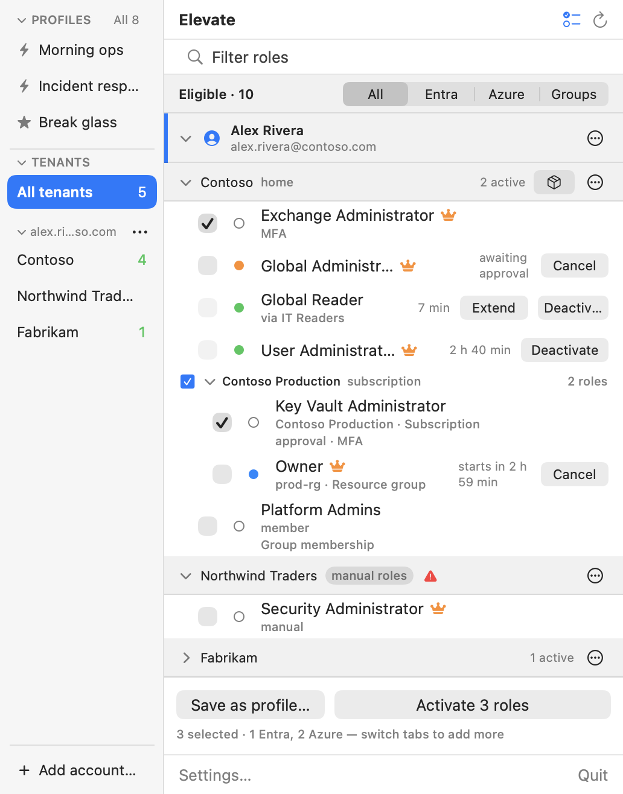

Name the profile. The sheet lists what running it will ask for today: the duration Elevate
remembers for each role, or the policy default, and which roles need approval.

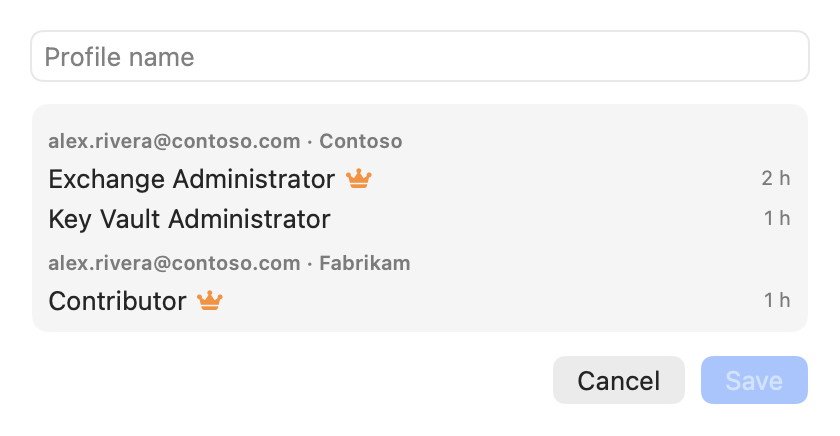

Click **Save**. The reason you type on a run is remembered per role, so later runs are pre-filled
with it. You can also start from an empty profile in the Profiles window and add roles there.

## Pin the profiles you use most

The top of the sidebar is the **Profiles** section: one button for each **pinned** profile, and
**All N** for the rest. A profile with several roles shows a bolt, a favorite (a profile of one
role) a star.

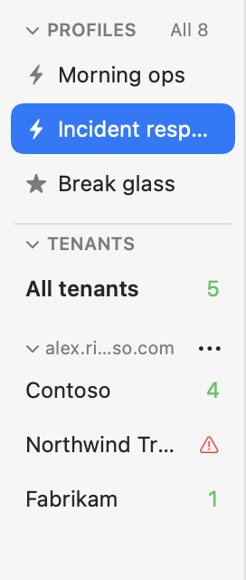

- Pin up to four profiles. The sidebar never grows past four, so the tenants below keep their
  room however many profiles you save; with more than four you would be reading a list anyway,
  and that is what **All N** is for. Names that do not fit are cut; hover for the full name, the
  role count and the global shortcut if one is bound.
- Pin from the All list, from a profile's menu, from the star in a profile's header, or from the
  Profiles window. When four are already pinned, the star in a profile's header is disabled and the All list says why; unpin one first.
- With profiles but nothing pinned, the section shows only **All N**. With no profiles at all,
  the section is hidden.
- Click **PROFILES** to collapse the section; the header then shows how many profiles you have.

## Run a profile

Click a profile in the sidebar. The main view shows it, ready to run, without opening a window:

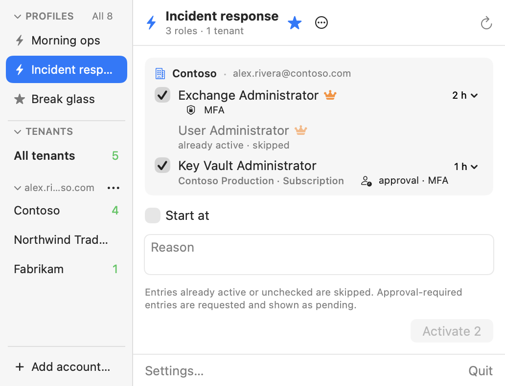

- The header names the profile and says how many roles and tenants it spans. It also shows the
  global shortcut if the profile has one, a star that pins or unpins it, and a menu with the same
  actions as the profile's context menu below.
- The roles are grouped by tenant and account. Each has a checkbox, ticked by default. Untick a
  role to leave it out of this run only; the profile itself is unchanged and the role is ticked
  again next time.
- Each role keeps its own duration, shown as a small menu at the right of its name (**2 h** with
  a chevron). Choose another for this run.
- Entries that are **already active** or **pending** are skipped, and the view says so. An entry
  you are no longer eligible for shows **not eligible · skipped**.
- Roles that need approval are requested and shown as pending afterwards.
- **Start at** schedules the whole run for later.
- The **Reason** field has the focus and is pre-filled with the reason you last gave. Enter a
  reason and click **Activate N**, or press Return. Nothing is requested until you do. Progress
  shows per row, and the results stay in the view until you select something else.
- Press Escape to go back to the tenant or **All tenants** you came from.

Closing the panel does not cancel a run or lose what you typed. Elevate keeps the profile view
for you: when you reopen the panel it shows the profile again if you left a draft, if a run is
still going, or if a run finished and you have not seen its results yet. The usual notification
reports the outcome when a run ends while the panel is closed.

**Option-click** a profile in the sidebar to run it without looking, using the remembered reason
and durations. If anything needs input, such as a missing reason or an MFA step, the profile
view opens instead.

The profile also opens in its own **run window**, with the same content, when the global
shortcut or a notification action needs input, and from **Run…** in the Profiles window; there
the panel is not open.

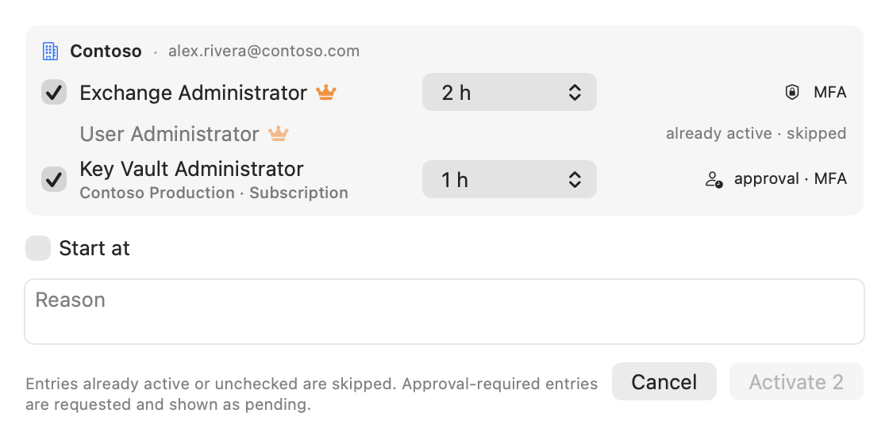

Right-click a profile in the sidebar for the rest:

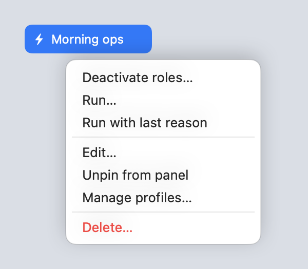

**Deactivate roles…** appears while some of the profile's roles are active. **Run with last
reason** is the same as Option-clicking, and is greyed out until the profile has a remembered
reason. A profile that your organization publishes shows **Show…** instead of **Edit…** and has no
pin or **Delete…**.

## Find any profile

**All N** opens the full list, pinned profiles first.

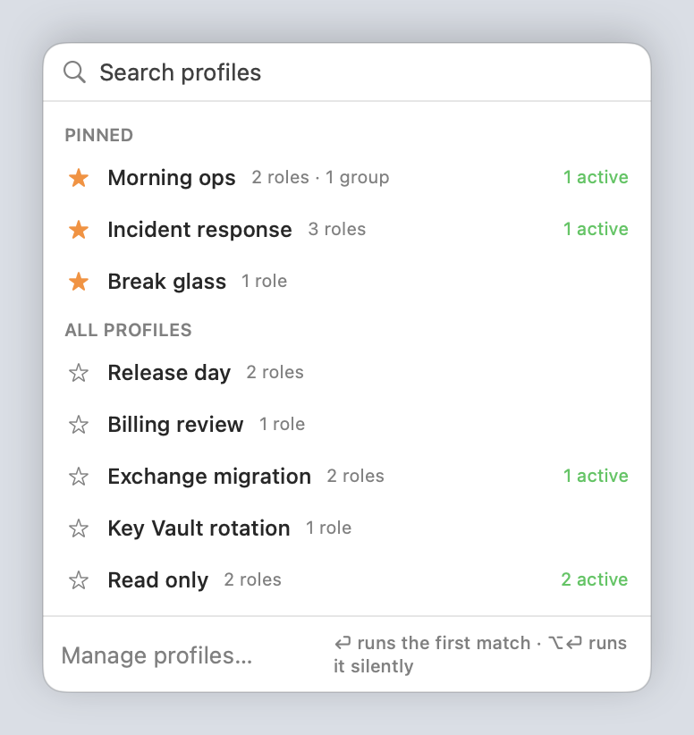

- Type to filter. **Return** runs the first match; **Option-Return** runs it silently.
  Running a profile from here shows it in the panel's main view, like a click in the sidebar.
- The star on each row pins or unpins it without leaving the list.
- Hover a row for **Run** and the **⋯** menu, the same menu as in the sidebar. A row whose roles
  are already active says so.
- **Manage profiles…** at the bottom opens the Profiles window.

## Edit a profile

Choose **Manage profiles…** from the All list, or **Edit…** from a profile's menu to open the window
on that profile.

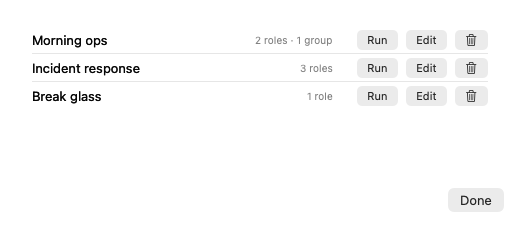

The list on the left holds every profile; the one you select is edited on the right, and every
change is saved as you make it. **Done** only closes the window.

- Rename in the name field. **Pinned in panel** puts the profile in the sidebar; the shortcut
  switch makes it the profile the global shortcut runs.
- The roles are grouped by account and tenant. Each shows the duration the next run will propose,
  which you can change here, and the **−** button removes it.
- **Add roles…** opens a picker over every account and tenant, with search and an
  All / Entra / Azure / Groups filter. Roles already in the profile are listed but greyed, so a
  search that finds nothing new tells you why. Tenants still loading are marked.

  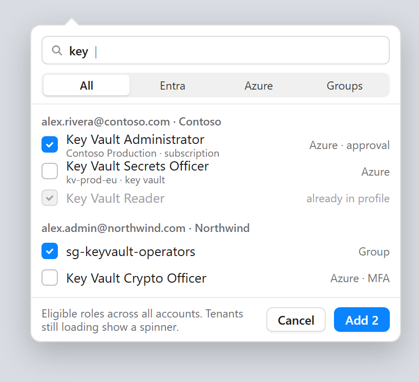

- **Run…** opens the run window. **Delete…** asks first; active roles are never touched.
- **+** under the list starts an empty profile. Drag rows to reorder; pinned profiles appear in
  the sidebar in that order.

## On Windows

The flyout and the Profiles window follow the same design with Fluent controls: the sidebar and
the profile view are the same, **Ctrl-click** a profile in the sidebar to run it silently,
**Enter** in the All list runs the first match, and **Add roles…** opens a dialog. Confirmations,
such as deleting a profile, are dialogs rather than cards inside the panel.

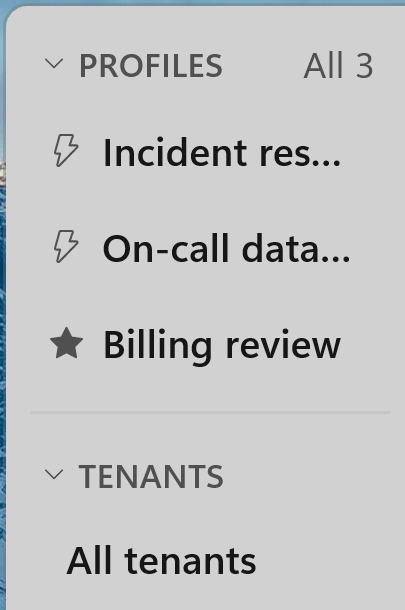

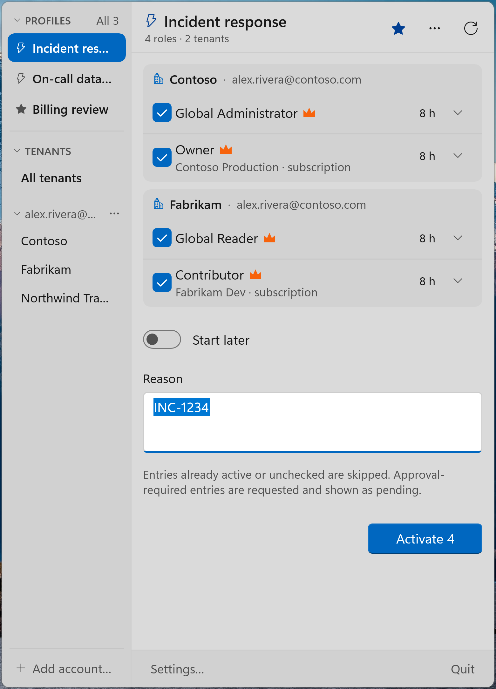

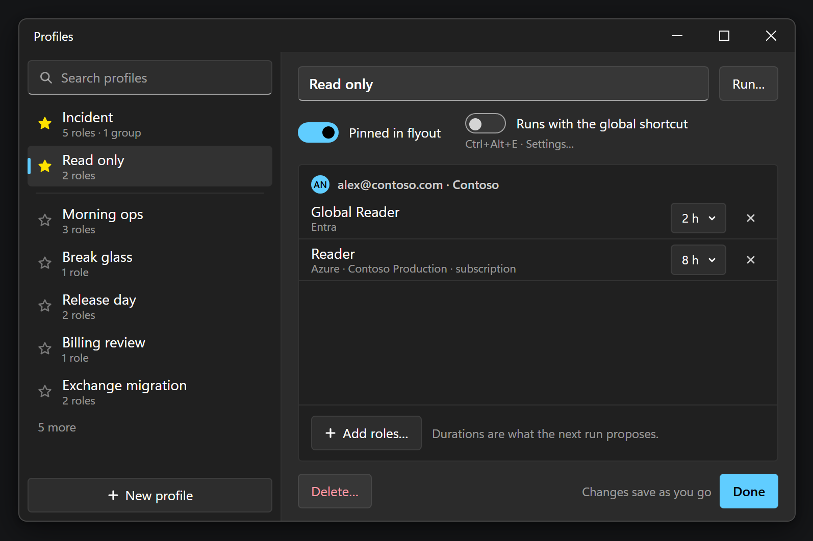

## A global keyboard shortcut

One profile can be bound to a system-wide shortcut, so you can run it without opening the
panel. In **Settings…** under **Global shortcut**:

1. Click **Record shortcut** and press a combination that includes ⌘, ⌃ or ⌥ (Ctrl, Alt or Win on
   Windows).
2. Choose the profile under **Runs profile**, or flip **Runs with the global shortcut** in the
   Profiles window.

The shortcut behaves like Option-clicking the profile: it runs silently when it can and opens the
run window when it needs input. If the system refuses the combination, Elevate says so under the
field; pick another.

## Tips

- Keep profiles small and specific. A profile that includes a role needing approval will always
  leave that role pending; put such roles in their own profile so the rest activate instantly.
- Pin the two or three profiles you run daily and leave the rest to the All list; Return in that
  list is one keystroke away from the sidebar button.
- Profiles remember roles by tenant and account. If you sign an account out and back in, its
  profiles keep working; if you remove a tenant, its entries are dropped from every profile.
- Selections can span tenants, and the footer reminds you that switching tenant or view adds more
  roles to the same selection.
